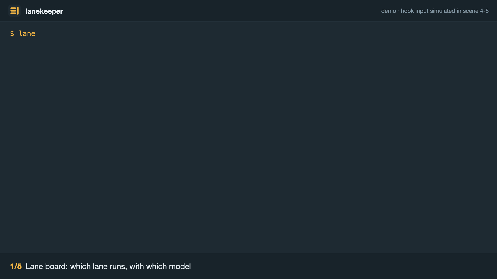

<!-- LANG-SWITCH -->
**English** · [한국어](README.ko.md)

# Lanekeeper — Agent Workbench

Lanekeeper is a Claude Code plugin that keeps the rules for running several subagent lanes at once in settings files and enforces them with hooks. It picks a model for each kind of task, limits how many lanes and heavy commands run at the same time, and stops a lane from committing to a protected branch or killing another task's server. When a lane finishes, a report file and a review checklist confirm the result.



```
# From the combined marketplace
claude plugin marketplace add wook8170/claude-plugins
claude plugin install lanekeeper@wook8170-plugins

# Or from this repository alone
claude plugin marketplace add wook8170/lanekeeper
claude plugin install lanekeeper@lanekeeper
```

Requires Node.js 18.19 or later and Claude Code 2.1.295 or later.

User manual: [docs/README.md](docs/README.md) — installation and the first 30 minutes, how to use each feature, every settings key, the rules, and troubleshooting.

## Background

Running several agent lanes in one repository produces the same incidents again and again. Heavy test suites run in parallel and time out, and the timeouts are reported as failures. A lane commits to another lane's branch or to the default branch. A pattern-based kill takes down another task's server. Rules written only as instructions are not always followed, so Lanekeeper keeps them as settings and checks them with hooks.

Measurements of code-search tool usage shaped the design. Sessions that used index-based search first and sessions that used only text search answered correctly at the same rate. About one third of index tool calls failed, mostly because the working folder had not been indexed. Runs that blocked text search cost more than three times as much. Lanekeeper therefore never blocks text search and queues unindexed paths for indexing instead.

## Install

Use one of the two install commands at the top of this page. Both install the same plugin. Use only one of them, so that Lanekeeper is installed once.

Claude Code 2.1.295 or later is needed (`onFailure: block` on the safety hooks). The hooks and commands run on Node.js 18.19 or later. Earlier Node.js 18 releases cannot run the extensionless `bin/lanekeeper-*` scripts as ES modules. Installing alone turns on the safety hooks only. The workflow hooks (dispatch guard, ship gate, handoff, checkpoint, load, slots, session rules) act only in a repository with `.lanekeeper/config.json` and do nothing elsewhere. Handoff, token guard, automatic resume and terse mode turn off when the Claude Code settings (`~/.claude/settings.json` and the like) already hook the same kind (`personal.global_hooks`).

Then run `/lanekeeper:init` in the project folder. It asks four questions:

1. Project kind (`web-ui` · `service` · `library` · `other`)
2. Message language (`ko` · `en`)
3. Full verification command (may be empty)
4. Whether Lanekeeper also manages the worktrees Claude Code creates (default no; see "Claude Code worktree hooks (opt-in)" below)

It writes `.lanekeeper/config.json` and `~/.lanekeeper/personal.json` and excludes the brief folder `.lanekeeper/briefs/` from git. Existing files are never overwritten.

**Claude Code only.** The plugin ships executables in `bin/`, so it installs in Claude Code and not in claude.ai or Cowork.

## Renamed from wb (0.2.0)

Before 0.2.0 this plugin was called `wb`. The commands are now `/lanekeeper:*`, the tools are `lanekeeper-*`, the settings folders are `~/.lanekeeper` and `<repo>/.lanekeeper`, and the environment variables are `LANEKEEPER_*`. To move from `wb`:

```
claude plugin uninstall wb@wb-plugin             # or wb@wook8170-plugins
claude plugin marketplace remove wb-plugin       # the marketplace of the old name
claude plugin install lanekeeper@wook8170-plugins  # or lanekeeper@lanekeeper
```

**Do not leave `wb` turned on next to `lanekeeper`.** Every hook would then run twice. Also stop loading an old folder with `--plugin-dir`. `claude plugin list` must show only `lanekeeper`.

Old settings keep working, and nothing is moved for you:

- `~/.wb` is read while `~/.lanekeeper` does not exist, and `<repo>/.wb/config.json` while `<repo>/.lanekeeper/config.json` does not exist. The lane state in `<git common dir>/wb` is used the same way.
- `WB_*` variables are read as `LANEKEEPER_*`. When both are set, `LANEKEEPER_*` wins.
- Briefs and decision files that start with `<!-- wb-brief` or `<!-- wb-decision` are still recognised.
- A gate pass stamp written as `wb-gate-pass.json` still counts for its commit. The next gate run writes `lanekeeper-gate-pass.json`.
- At the first session that uses an old name, the plugin says once which old names it read.

To switch to the new names, close the running sessions and rename the folders yourself:

```
mv ~/.wb ~/.lanekeeper
git mv .wb .lanekeeper         # in each project; plain mv if .wb is not tracked
mv .git/wb .git/lanekeeper     # lane state, in each repository
```

The new default branch names are `lanekeeper/*/int` and `lanekeeper/*/l*`. To keep lanes that were started under `wb/…`, set `git.integration_branch_pattern` and `git.lane_branch_pattern` back to `wb/*/int` and `wb/*/l*` in `.lanekeeper/config.json`. Claude Code keeps plugin data per plugin name, so limit records, token guard totals and automatic resume logs start fresh under the new name.

The old `wb-*` commands have no aliases. Replace them in your own scripts, `CLAUDE.md` files and permission rules such as `Bash(wb-config:*)`:

| Before 0.2.0 | Now |
|---|---|
| `wb-art` | `lanekeeper-art` |
| `wb-cases` | `lanekeeper-cases` |
| `wb-check` | `lanekeeper-check` |
| `wb-config` | `lanekeeper-config` |
| `wb-decide` | `lanekeeper-decide` |
| `wb-defects` | `lanekeeper-defects` |
| `wb-docs` | `lanekeeper-docs` |
| `wb-explain` | `lanekeeper-explain` |
| `wb-index` | `lanekeeper-index` |
| `wb-integrate` | `lanekeeper-integrate` |
| `wb-number` | `lanekeeper-number` |
| `wb-port` | `lanekeeper-port` |
| `wb-quality` | `lanekeeper-quality` |
| `wb-reap` | `lanekeeper-reap` |
| `wb-retry` | `lanekeeper-retry` |
| `wb-route` | `lanekeeper-route` |
| `wb-rules` | `lanekeeper-rules` |
| `wb-slot` | `lanekeeper-slot` |
| `wb-style` | `lanekeeper-style` |
| `wb-terse` | `lanekeeper-terse` |
| `wb-test-report` | `lanekeeper-test-report` |
| `wb-token` | `lanekeeper-token` |
| `wb-waves` | `lanekeeper-waves` |
| `wb-work` | `lanekeeper-work` |
| `wb-worktree` | `lanekeeper-worktree` |

## What it runs, sends and fetches

### What it runs

Every hook is a Node.js script in `hooks/scripts/`, started as `"${CLAUDE_PLUGIN_ROOT}"/hooks/scripts/…`. The safety hooks run in every repository. All other hooks act only in a repository with `.lanekeeper/config.json`.

| Event | Hook | What it does |
|---|---|---|
| PreToolUse (Bash, Write, Edit, MultiEdit, NotebookEdit, Skill) | `safety/pretool` | Judges the command or target path and allows, asks or denies. Reads git state, and `lsof`/`ps` (or `/proc`) to find who owns a port. Runs `gh pr view` before a `gh pr merge` |
| PreToolUse (Agent, Task) | `dispatch/dispatch-guard` | Checks the model, the lane count and the brief of a subagent call |
| PreToolUse (Agent, Task, Skill) | `quality/ship-gate` | Before ship verification starts, checks that the required quality results passed on the current commit |
| PreToolUse (Bash) | `slots/slot-guard` | Asks to run heavy commands inside `lanekeeper-slot` |
| PreToolUse (Write, Edit, MultiEdit) | `mockup/mockup-first` | When `project.mockup.decision_required` is on, asks for a decided mockup before a screen structure change |
| PreToolUse (Bash, Grep) | `codegraph/nudge` | Suggests `rg` instead of a recursive `grep` |
| PreToolUse (codegraph MCP tools) | `codegraph/deadpath` | Stops repeated calls for a path with no index |
| UserPromptExpansion (`lanekeeper:approve`) | `safety/approve` | Writes a one-time owner grant to `<git common dir>/lanekeeper/owner-grant.json` |
| SessionStart | `handoff/session-start`, `auto-retry/session-start`, `terse/session-start`, `codegraph/session-start`, `rules/session-start` | Adds context: `progress.md` summary, waiting resumes, terse mode, codegraph guidance, working rules, and the one-time notice about old `wb` names |
| SessionStart | `worktree/session-sync` | Only when `project.worktree.hook` is `true`: keeps the WorktreeCreate/WorktreeRemove entries in the main checkout's `.claude/settings.local.json` pointed at the current plugin, and removes them when the setting is turned off |
| UserPromptSubmit | `token-guard/check`, `load/check` | Reads usage and load average, and adds a line when a threshold is reached |
| PostToolUse, PostToolUseFailure (codegraph MCP tools) | `codegraph/record` | Records ok/empty/error to `.lanekeeper/metrics/codegraph.jsonl`; for an unindexed path, queues it and starts a background `codegraph` index run on this machine (`project.codegraph.auto_index`, default on) |
| PostToolUse | `token-guard/check` | Same as above |
| Stop | `handoff/stop-guard`, `report/artifact-check` | Can keep the session from ending until `progress.md` or the report is updated |
| Stop, StopFailure | `auto-retry/detect` | Only when automatic resume is on: records the limit and schedules a resume |
| StopFailure, SubagentStop, PreCompact | `checkpoint/checkpoint` | On a lane branch (`lanekeeper/*/l*`) only: commits tracked changes as a `wip(lanekeeper)` commit. Secret-looking files and untracked files are left out. Nothing is pushed |
| SubagentStart, SubagentStop | `ledger/subagent` | Records model and token counts per lane in `<git common dir>/lanekeeper/` |

`settings.json` sets the subagent status line to `lanekeeper-waves statusline`. The 25 `bin/lanekeeper-*` tools run only when you or Claude call them. They run `git`, `gh` (PR lookup), `lsof`, `ps`, `codegraph`, `sqlite3`, `nice`, `python3` (workbooks), `cwebp` (image conversion), `osascript`/`notify-send` (desktop notifications) and the commands you put in the project settings. `lanekeeper-slot reap --orphans --kill` stops listed orphan processes one PID at a time, and only with `--kill`. `lanekeeper-worktree remove` and `lanekeeper-index orphans --apply` delete only when you ask.

**Automatic resume (off by default).** After `/lanekeeper:auto-retry on`, a usage limit that ends a turn makes the Stop hook write a one-shot job: a launchd agent in `~/Library/LaunchAgents/lanekeeper.auto-retry.<id>.plist` on macOS, a systemd user timer on Linux, or a background waiter elsewhere. At the reset time the job runs `claude --resume <id> -p <prompt>` in the default permission mode and removes itself. `lanekeeper-retry off` and `lanekeeper-retry cancel all` undo it.

### What it sends

Nothing the plugin collects leaves the machine. All records stay in local files (`${CLAUDE_PLUGIN_DATA}`, `~/.lanekeeper`, `<repo>/.lanekeeper`, `<git common dir>/lanekeeper`). The plugin makes no HTTP calls of its own except the local check below, and it reads no credentials.

- `gh pr view` runs when Claude runs `gh pr merge`. It asks GitHub for that PR's base branch through your existing `gh` login.
- The review's serving check (`lanekeeper-check lane --serve-url`) reads one page from `localhost`, `127.0.0.0/8` or `[::1]` only.
- An automatic resume, when you turned it on, starts `claude` with your Claude Code login, as you would by hand.
- The report skill asks Claude to publish a report with Claude's own Artifact tool when that tool is available. That page goes to your claude.ai account.

### What it fetches

The plugin downloads and installs nothing by itself. When codegraph, ripgrep, Python with openpyxl or cwebp is missing, it prints the install command. For codegraph and ripgrep, the guidance it gives Claude says to ask you first and to install only after you agree.

## Settings

Settings come in four layers.

| Layer | File | Tracked | Contents |
|---|---|---|---|
| default | plugin `defaults/*.json` | plugin repository | default for every key |
| project | `<repo>/.lanekeeper/config.json` | committed | project kind, branch rules, output locations, verification command, writing-style map |
| machine | `~/.lanekeeper/machine.json` | no | lane count, run slots, load threshold, protected ports, lane port range |
| personal | `~/.lanekeeper/routing.json`, `~/.lanekeeper/personal.json` | no | model routing and denied models, language, report detail, unattended resume, the separate plugin used for large designs (`design_plugin`) |

The language and report detail chosen in the plugin settings screen (`/config`) sit between the machine layer and the personal files. Hook processes are the only place these values are visible.

Merge rules depend on the kind of key.

| Kind | Rule | Keys |
|---|---|---|
| ordinary value | the higher layer wins: personal > plugin option > machine > project > default | every key not listed below |
| protected list | union of all layers; no layer can remove an entry another layer added | `routing.denied`, `machine.ports.protected`, `project.git.protected_branches`, `project.protected_paths` |
| cap | the smallest value among the non-default layers; the default applies only when no other layer sets it | `machine.lanes.max`, `machine.slots.heavy.count`, `machine.slots.browser.count`, `machine.load.max` |

The default is left out of the cap rule so that a personal machine file can raise the cap above the default of three lanes. A project can only lower it further.

To see where a value comes from:

```
lanekeeper-config explain machine.lanes.max
lanekeeper-config validate
lanekeeper-config doctor
```

`explain` shows the merge rule, the layer that won and every layer that sets the key. `validate` checks each file and names the file and key of every error. Unknown keys are ignored with a warning.

Example files are in `examples/`.

## Model routing

`routing.json` gives each kind of task a chain of models and a floor. Lanekeeper removes denied models and models that hit their usage limit from the chain, then uses the first remaining model if it is at or above the floor. If only models below the floor remain, Lanekeeper does not dispatch, notifies you and waits. The plugin defaults deny no model. To stop using a model, add it to `denied` in your personal `routing.json`.

Tasks with `differ_from: implementer` (adversarial review) drop the implementer's model from the chain. If no other model at or above the floor is left, the same model runs in a fresh context and the lane report has to say so.

`lanekeeper-route` previews the result.

```
lanekeeper-route tasks                                  chain and floor per task type
lanekeeper-route resolve review                         model to use (agent_param); exit 3 while waiting
lanekeeper-route explain adversarial --implementer opus step-by-step trace
lanekeeper-route check review --model sonnet            judge a model choice (exit 1 when blocked)
```

### Dispatch checks and briefs

When a subagent is dispatched (Agent tool), a hook checks:

| Condition | Result |
|---|---|
| No brief marker, missing sections or statements, unfilled `{{…}}` | Block (`project.dispatch.brief: warn` only advises) |
| No `model` | Block, names the routed model |
| Denied or out-of-quota model | Block, names the next model in the chain |
| Model below the declared task's floor or outside its chain | Block |
| In the chain but not the first choice | Advice |
| Every model at or above the floor is out of quota | Block, notify, wait until the reset, suggest `/model` |
| New lane while `machine.lanes.max` lanes are live | Block |

The first line of a brief is the marker `<!-- lanekeeper-brief v1 type=<task> lane=<lane> template=<template> -->`. Required sections are goal, scope, do-not, test rules, report location and commit rules; the text must also state headless browsers, no full test suite, and the worktree base commit hash. Seven templates (impl, fix, mockup, research, review, docs, test) are in `templates/briefs/ko` and `templates/briefs/en`. Check a brief with `lanekeeper-check brief <file>`. When a brief names a common brief file, that file is read and judged together with it.

Agents listed in `project.dispatch.exempt_agents` (default: `fork`, `claude-code-guide`, `statusline-setup`) skip the brief check. The denied-model check still applies.

## Safety hooks

A `PreToolUse` hook judges Bash, Write, Edit, MultiEdit, NotebookEdit and Skill calls before they run. The answer is allow, ask or deny. A block message has three lines: why it was blocked, how to fix it, where to ask.

**Actor.** A hook input with `agent_id` comes from a subagent, i.e. a lane. Without it, a call is still a lane call when the target worktree is registered in the lane ledger (`<git-common-dir>/lanekeeper/lanes.json`). Everything else is the main session.

**git table.**

| Action | Lane · own branch | Lane · elsewhere | Main · integration/feature | Main · protected |
|---|---|---|---|---|
| commit · cherry-pick · revert · am | allow (with `lanes.commit: on-instruction`, asks unless the brief allows commits) | deny | allow | deny; once with a `commit-main` grant |
| merge · rebase · pull | only taking in the integration branch | deny | allow (denied while the gate lock is held) | deny; `merge-main` grant plus gate stamp. Syncing with its own upstream is allowed |
| push | deny | deny | `git.feature_push` (ask · allow · deny) | deny; `push-main` grant plus gate stamp |
| force push · `--all` · `--mirror` | deny | deny | deny | deny |
| `gh pr merge` | deny | deny | a protected base needs a `merge-main` grant | same |
| checkout · switch to another branch | deny | deny | allow | allow |
| unnamed stash · `reset --hard` · `clean -f` · `branch -D` | ask | ask | ask | ask |
| deleting or force-moving a protected branch | deny | deny | deny | deny |

Commands are unpacked before judging: `;` `&&` `||` `|`, subshells, `$( )`, `sh -c`, `eval`, heredocs, wrappers such as `env`, `sudo`, `timeout` and `xargs`, shell and git aliases, `git -C`, `cd` and `GIT_DIR`. A command whose name or target folder is a variable is blocked.

**Owner grants.** Changes to a protected branch need the repository owner to type `/lanekeeper:approve merge-main` (or `push-main`, `commit-main`) in the prompt. A grant is valid once, for 15 minutes (`git.owner_grant_ttl_min`), for the commit recorded when it was typed. When the project has a gate command (`gate.command`), a gate pass stamp for the same commit is also required. Grants are written by a `UserPromptExpansion` hook. That event fires only when a person types a slash command, so subagent reports and messages from other sessions cannot create one. The model cannot invoke the skill or write the grant file.

**Other owner decisions.** The same command takes three decisions that an agent must not make for itself. They take effect at once: `/lanekeeper:approve accept-quality <kind> --reason why` (accept a weakened test result), `/lanekeeper:approve retry-bypass` (let the automatic resume use `bypassPermissions`) and `/lanekeeper:approve clear-gate-lock` (remove an old gate lock). The files they write cannot be written by Bash or the file tools either. Commands inside script files are outside this check, as with every safety hook.

**Approving in a dialog.** Accepting a weakened result and clearing a gate lock can also be confirmed in a dialog. When the main session's agent runs `lanekeeper-quality accept <kind> --reason "why"` or `lanekeeper-reap --gate-lock` alone on one line, a dialog appears. It shows the kind, commit, weakening and reason, or the age and process of the lock. Allow runs the command, and decline changes nothing. `retry-bypass` turns permission checks off, so it stays slash-only.

In these cases the hook refuses without a dialog and points at the slash command:

- The permission mode is not `default`, `acceptEdits` or `auto` (`plan`, `dontAsk`, `bypassPermissions`)
- The session is `-p` or the SDK
- A subagent asked. A request from inside a lane goes up to the main session
- The command is chained, piped or wrapped, or has a path, an environment prefix or added options
- A `permissions.allow` rule covers the command. `/lanekeeper:doctor` warns about this too

The hook adds a one-use ticket to the end of the allowed command. The ticket works once within 10 minutes and is tied to what the dialog showed, so a new result or a changed lock after the dialog was raised is refused. Only its hash is stored. Decisions carried out are written to `<git common dir>/lanekeeper/owner-decisions.jsonl` with their route (`dialog` or `slash`), and an acceptance also has `via` in `accepted.json`.

**Other blocks.**
- Kills: name-based kills (`pkill`, `killall`, `kill $(pgrep ...)`) are blocked. `kill <PID>`, `lsof -ti :port | xargs kill` and `fuser -k` are blocked when the target listens on a protected port (`machine.ports.protected`).
- Deletes: `rm -r` of `/`, the home folder, system folders, the project root or `.git` is blocked. Outside the project it asks; inside the project and temp folders it passes.
- Browsers: Chrome without headless mode, `--headed`, `PWDEBUG`, `playwright codegen` / `--ui`, and `open` with a browser or URL are blocked.
- Paths: writes to `project.protected_paths` are blocked, and so are writes to Lanekeeper state files (grant, gate stamp, lane ledger). Editing a Lanekeeper settings file asks first.
- Protected data: commands that write to a database file, database port or container in `project.protected_data` (psql, mysql or sqlite3 sending write SQL, `pg_restore`, a writing `docker exec`, `docker cp`, overwriting the file) are blocked for lanes and ask first in the main session. When it cannot be told whether a command writes it asks; read-only queries pass.

**Fail-closed.** With a settings error, git changes, kills, deletes and browser runs are blocked and the message points at the faulty file and key. An internal hook error also blocks.

**Protected lists only grow.** `protected_branches`, `protected_paths`, `protected_data`, `ports.protected` and `denied` are the union of every layer. No layer can remove an entry another layer added.

## Session helper hooks

| Feature | Behavior | Setting keys | Manage |
|---|---|---|---|
| Handoff | `progress.md` holds the current state only (300 lines or fewer by default). At a new session and `/clear`, injects the whole file and how to search the archive. If a commit or file change is newer than the file, blocks the end of the turn once and asks to append finished content to `docs/progress-archive/progress-<YYYY-MM>.md` and rewrite `progress.md` whole. The same session is not blocked again for 20 minutes. A file over the line target is reported at session start, at the end of a turn and in the resume report; an accumulated file is moved with `lanekeeper-waves handoff migrate` | `personal.handoff.{enabled, file, throttle_min, max_lines, archive_dir}` | `lanekeeper-waves handoff` |
| Automatic resume | When a usage limit ends a turn, resumes the same session headless two minutes after the reset time. Scheduling uses launchd on macOS, a systemd user timer on Linux and a background waiter elsewhere. The model that hit the limit is recorded in `limits.json` | `personal.auto_retry.{enabled, permission_mode, bypass_ack}`, `routing.limits_state` | `lanekeeper-retry`, `/lanekeeper:auto-retry` |
| Token guard | Judges from the official five-hour and seven-day usage Claude Code keeps, plus an estimate of the local use since then, and adds an instruction only when the stage rises. 90%: smaller work units. 95%: handoff after every wave. 99%: last handoff, notification, then wait | `personal.token_guard.{enabled, stages, budget, window_hours, fresh_min, source}` | `lanekeeper-token`, `/lanekeeper:token-guard` |
| Terse mode | In a repository where it is on, injects rules that shorten output and tool calls at session start | `personal.terse`, repository switch | `lanekeeper-terse`, `/lanekeeper:terse` |
| Session rules | Adds working rules no hook can check at session start, after `/clear` and after a compaction: output language (`personal.language` set to `ko` or `en`), remote viewer (`personal.report.viewer: remote`: no local addresses, artifacts, base64 images, 2x captures), reporting, communication and fixing rules (implemented vs deployed, ask when unclear, fix the root cause, no emoji in the product UI) | `personal.session_rules.{language, remote, conduct}` | |
| Checkpoint | On a limit, a subagent stop or a context compaction, commits changes to tracked files on a lane branch as a `wip(lanekeeper)` commit. With `project.lanes.commit` set to `on-instruction`, only lanes whose brief allows commits are committed. Untracked files and secret-like files (`.env*`, `*.pem`, `*.key`, `id_*`, `*credentials*`, `*.p12`) are not committed; they are reported in `.git/lanekeeper/checkpoint.json` and a notification. If a project hook (pre-commit) fails, the checkpoint is skipped and the reason recorded. Protected and non-lane branches are left alone and nothing is pushed | `personal.checkpoint.enabled` | |

The permission mode of the automatic resume defaults to `default`. In that mode tools that need approval are refused in the unattended run, so the resumed work can stop at that point. `bypassPermissions` is enabled only when a person types `/lanekeeper:approve retry-bypass` in the prompt. Without that acknowledgement (`bypass_ack` in `~/.lanekeeper/personal.json`) the resume uses `default`, and project settings cannot supply it.

The token guard first uses the official usage stored in `~/.claude.json`; once it is older than 10 minutes, the local use since then is converted with a per-account calibration ratio and added. Calibration is automatic; values seen in the app can be added with `lanekeeper-token calibrate --five <n> --seven <n>`. Without an official value the budget (`personal.token_guard.budget`, default 0) is used, and with neither a budget nor a calibration the guard stays silent.

## Run slots, ports and lane worktrees

**Run slots.** Heavy runs (full test suites, builds, installs, e2e, indexing) and headless browsers are counted across the machine: 2 heavy and 2 browser slots by default. This count is separate from the lane limit (`machine.lanes.max`, default 3).

```
lanekeeper-slot --kind heavy -- pnpm -r test
lanekeeper-slot --kind heavy,browser -- pnpm exec playwright test
lanekeeper-slot status        # slots in use and the 1-minute load
lanekeeper-slot reap          # reclaim finished leases
```

- The command waits while no slot is free or while the 1-minute load is at or above `machine.load.max` (default: logical cores × 2). With `--timeout <sec>` it gives up after that long without running (exit code 75).
- A lease is renewed while the command runs. When its process is gone, or it has not been renewed for `machine.slots.stale_after_min` (default 90), the next caller reclaims it.
- Runs that need both kinds (e2e) take both slots together; if only one is free it is given back and the run waits.
- Commands run in a slot get `LANEKEEPER_SLOT_HELD`, so a nested `lanekeeper-slot` of the same kind does not wait for itself.

Heavy commands are recognised by the pattern groups in `defaults/heavy-patterns.json`. `machine.slots.heavy.patterns` and `machine.slots.browser.patterns` pick the groups, and a project can add regular expressions under `slots.heavy` and `slots.browser` in `.lanekeeper/config.json`. Single-file test runs (`vitest run a.test.ts`) are not matched. When the Bash tool runs such a command outside a slot, `machine.slots.guard` decides:

| Value | Behaviour |
|---|---|
| `warn` (default) | the command runs; Claude is told the wrapped command |
| `deny` | the command is blocked with the wrapped command as the fix |

**Ports.** Protected ports (`machine.ports.protected`) and the lane port range (`machine.ports.lane_range`) are numbers that live only in machine settings. Docs and briefs use names and ask `lanekeeper-port get <name> [--lane <id>]`. A lane leases one band (one port per `per_lane` name). Bands start at 41000, 20 ports apart, which keeps clear of macOS AirPlay on 7000. Bands holding a protected port, a port another process already listens on, or another lane's lease are skipped. The lease ledger is `<git-common-dir>/lanekeeper/ports.json`.

**Lane worktrees.**

```
lanekeeper-worktree create l3            # from the integration HEAD, with a port lease and a lane entry
lanekeeper-worktree list
lanekeeper-worktree remove l3 [--force] [--delete-branch]
```

- The base is the integration branch HEAD. The integration branch is `--integration`, else the lane registry's `integration`, else the one local branch matching `project.git.integration_branch_pattern`. Without one, the current HEAD is used.
- The branch name replaces the last part of the integration branch with the lane id (`lanekeeper/mvp/int` → `lanekeeper/mvp/l3`). The path is `project.git.worktree_root` (default `{repo}/../wt-{task}`).
- Git-ignored files listed in `.worktreeinclude` (such as `.env`) are copied.
- `project.worktree.setup` (for example `pnpm install --frozen-lockfile`) runs in the new worktree inside a heavy slot, with `LANEKEEPER_LANE` and `LANEKEEPER_PORT_<NAME>` set.
- No worktree is created once live lanes reach `machine.lanes.max`.
- Removal stops while any process runs inside the path and lists the PIDs; stop them one by one with `kill <PID>` and run again. Uncommitted changes need `--force`. The main checkout and folders that are not worktrees are never removed. `--delete-branch` deletes the branch only when its commits are on another local branch too.

**Claude Code worktree hooks (opt-in).** Once a WorktreeCreate hook is registered it replaces Claude Code's own worktree creation entirely (`claude --worktree`, `EnterWorktree`, subagents with `isolation: "worktree"`, background sessions); a registered hook cannot hand the work back to the default. So Lanekeeper does not list these hooks in its plugin `hooks.json`, and they are off by default. Answer yes to "Should Lanekeeper manage lane worktrees?" in `/lanekeeper:init`, or set `"worktree": { "hook": true }` in `.lanekeeper/config.json`, and Lanekeeper registers WorktreeCreate and WorktreeRemove hooks in the main checkout's `.claude/settings.local.json` (this machine only, kept out of git). The plugin's install path changes with each update, so a session-start hook re-points the registration to the current plugin every time and removes it when the setting is turned off. If another tool already has a WorktreeCreate hook there, Lanekeeper does not add its own and says so. Check with `lanekeeper-worktree hooks status`; apply now with `lanekeeper-worktree hooks sync`.

When on, the Lanekeeper hook keeps Claude Code's location (`.claude/worktrees/<name>`) and branch name (`worktree-<name>`), bases the worktree on the integration HEAD when there is exactly one integration branch, and also leases ports, copies `.worktreeinclude` files and runs the setup command. These worktrees are not added to the lane registry. If no heavy slot comes free within 2 minutes the setup command is skipped; run `lanekeeper-worktree setup <name>` later. Claude Code's own extras (branching from the remote default branch, filter-driver neutralisation, the stale worktree sweep) do not apply in this mode.

**Cleanup.** `lanekeeper-reap` reclaims finished slot leases and lists port leases and lane entries whose folder is gone (`--apply` clears them). An old `gate.lock` is only reported, and the owner removes it by typing `/lanekeeper:approve clear-gate-lock` in the prompt, or by allowing the dialog that `lanekeeper-reap --gate-lock` raises in the main session. It never stops processes.

## Lane ledger, progress board and resume

Wave and lane progress is recorded under `<git common dir>/lanekeeper/`, shared by every worktree. Only `lanekeeper-waves` writes it.

- `waves.json`: lane state per wave (pending, running, review, blocked, failed, done), model, task type, brief path, runs and returns, to-dos, checks, token totals, history.
- `dispatch.json`: dispatches that passed the guard and the agents running now.
- `metrics/lanes.jsonl`: one line per start, stop, status change and return, with task, routed model, actual model, classification source, brief file hashes and tokens.
- `lanes.json`: the lane worktree registry (L4); an agent start writes its `agent_id`.

The dispatch guard remembers every allowed call. SubagentStart pairs the agent with the oldest pending call of the same agent type, sets the lane to running and counts the run. SubagentStop adds the transcript usage and sets the lane to review. A new agent on a lane in review counts as one return. A brief marker without `lane=` is logged in metrics only. Pending calls expire after 10 minutes.

Commands: `lanekeeper-waves init-wave | lane | status | todo | verify | note | return | board | metrics | statusline | resume`, `lanekeeper-number reserve | release | list | check`, `lanekeeper-cases init | add | retire | set | list | check`, `lanekeeper-defects add | resolve | list | check`. Skills: `/lanekeeper:lanes`, `/lanekeeper:pickup`, `/lanekeeper:resume`. The resume report lists the whole progress.md (only the newest section of an oversized accumulated file) and the archive location, git status, worktrees, the last five commits and lane verdicts, and reports stale items first (outdated progress.md, progress.md over `personal.handoff.max_lines` (default 300), running lanes idle longer than `project.waves.stale_min`, missing or unregistered worktrees, uncommitted lane changes, orphan dispatches, agents without a stop record). It never deletes anything.

**progress.md and the archive.** `progress.md` holds the current state only. It starts with one line naming the archive and how to search it, followed by the sections goals and owner decisions, branches and servers, in progress (table), next, waiting for answers, system notes and resume commands. It is rewritten whole every wave. Finished content (completed waves, answered questions, state that no longer holds) is appended to the end of `docs/progress-archive/progress-<YYYY-MM>.md` as a `## <YYYY-MM-DD HH:MM> — <summary>` section. When finished and current items are hard to separate, `lanekeeper-waves handoff archive "<summary>"` appends the whole current file before the rewrite; its headings are moved one level below the dated section. A file that has already grown by accumulation is moved whole by `lanekeeper-waves handoff migrate` to `docs/progress-archive/progress-until-<YYYY-MM-DD>.md` (`git mv` when tracked), and a fresh file with the sections above takes its place. History is never deleted; find what you need with `grep -n '<keyword>' docs/progress-archive/*.md`. `personal.handoff.archive_dir` changes the folder. `lanekeeper-waves handoff check [--json]` prints the line count and the archive files and exits 1 when the file is over the target.

Number series (`numbers` in `.lanekeeper/config.json`: `dir`, `pattern`, `width`, `start`) give parallel lanes unique numbers for migrations or decision records. The next number is above the files in the folder (working tree and main checkout) and above live reservations. Test cases (`<module>.cases.json`) and `defect-register.json` live in `paths.e2e_ledger`; case ids are never reused, a `fixme` case must point to an open defect, defects are never deleted.

## Test result workbook

The result of an integration or final verification is saved as an Excel workbook (xlsx) plus a summary json. The generator needs Python 3.8+ and openpyxl (`python3 -m pip install openpyxl`; where pip is blocked, use the virtual environment steps in `docs/en/01-getting-started.md`). Without them `lanekeeper-test-report` prints the install commands and skips only the workbook (exit 0, or 3 with `--require`). Check with `lanekeeper-test-report env`.

| Where | What |
|---|---|
| `templates/test-results/core/` | result model, adapters (vitest, jest, Playwright, pytest), ledger comparison, sheet layout. It reads result files only and knows no project names or paths |
| `templates/test-results/project/` | `verify-all.mjs` (gate, then each test stage, then the workbook; keeps going after a failure), `run-gate.mjs` (records the gate step by step), `verify.config.json` (the stage list per stack) |

```
lanekeeper-test-report init                  create .lanekeeper/verify.config.json (edit gate and stages for the project)
lanekeeper-test-report run [--name N] [--only a,b] [--skip a,b] [--ledger-priority P0] [--no-slot]
lanekeeper-test-report build --input vitest:unit:app=out.json[,log=out.log] [--gate-json gate.json] [--rerun playwright=again.json]
lanekeeper-test-report gate-pass             run project.gate.command; a pass writes the gate pass stamp
lanekeeper-test-report latest | summary [--json]
lanekeeper-check test-results [--json] [--require-pass]
```

`lanekeeper-test-report run` and `gate` hold `<git common dir>/lanekeeper/gate.lock` while they run. Merges wait meanwhile, and a second gate run stops with exit code 3. The lock is removed when the run ends. When `run` (without `--only` or `--skip`, which pick a part) or `gate-pass` passes with no uncommitted changes, it writes the gate pass stamp (HEAD commit, time, command) to `<git common dir>/lanekeeper/<git.gate_stamp>.json`. The protected-branch check reads that stamp, and treats commits after it that change only files in the results folder (`paths.test_results`) as the same commit. The HEAD comparison in `lanekeeper-check test-results` follows the same rule.

Each stage names an `adapter` (vitest, jest, playwright, pytest), a `kind` (unit, integration, e2e, uistab), a `cmd` (`{file}` is where the structured output goes) and a `slot` (`heavy`, `heavy,browser`, `none`). Heavy stages run inside `lanekeeper-slot`. A run that only left logs is read with `build --input adapter:kind:name=log=<log>`.

Sheets: summary, unit, integration DB, e2e, e2e detail, UI stability, gate steps, failures, flaky, ledger comparison, coverage, mutation. Sheet names are Korean and fixed. A sheet without data is not created (summary, failures and flaky always exist). A test that passes on a retry inside the run, or in a separate rerun (`--rerun`), counts as flaky. The ledger comparison matches `*.cases.json` in `paths.e2e_ledger` with the case ids in test titles (`PAY-001`, and the short form `PAY-002 · 003`). Mismatches are: an active case that failed, was flaky, was skipped or did not run (`--ledger-priority`), a `fixme` case that passes, and ids that are unknown or retired. With a ledger, 0 mismatches is a ship condition.

The workbook goes to `paths.test_results` (default `docs/test-results/<date>/<name>-<HHMM>.xlsx`, with a `.json` of the same name) and is committed. Raw logs go to `paths.test_runs_raw` and are not committed. A broad `.gitignore` pattern such as `test-results/` also hides `docs/test-results/`; `/lanekeeper:init` suggests the exception line and `lanekeeper-check test-results` reports the files as not committed. `/lanekeeper:report` attaches `file` and `json` from `lanekeeper-check test-results --json` and quotes the figures of `lanekeeper-test-report summary --json`.

**Results per kind and the ship precheck.** `lanekeeper-quality` keeps the unit, integration, gate, e2e, UI stability, usability and ship verification results separately as `docs/test-results/<version>/<date>/<kind>-<HHMM>.json` and `.xlsx`, and updates the index (`index.json`, `INDEX.md`). The commands go into `quality.suites` of `.lanekeeper/config.json` (example: `examples/quality-config.json`). The quality skills (`/lanekeeper:quality-unit`, `/lanekeeper:quality-integration`, `/lanekeeper:quality-gate`, `/lanekeeper:quality-e2e`, `/lanekeeper:quality-uistab`, `/lanekeeper:quality-usability`) run one kind each, and `/lanekeeper:quality-report` builds the version roll-up (workbook, Markdown, HTML). With `quality.ship.requires` set, a hook checks the newest result of each kind before a ship verification skill or agent starts. A missing result, a result of another commit or a failed one blocks it, and `/lanekeeper:ship-verify` (`lanekeeper-quality precheck --run`) runs them again. A result with fewer tests, more skipped or fixme tests, or a loosened threshold than the previous passed one also blocks it.

**Adversarial UX check.** In `/lanekeeper:quality-ux-adversarial` the checker agent `lanekeeper:ux-adversary` (Fable recommended, Opus otherwise), in a context separate from the implementing session, drives the real screens headless and does a persona's real tasks end to end in an isolated stack, and finds where a first-time user gets stuck, goes wrong or loses work, on nine required axes (logic errors, information consistency, user context, flow context, a first-time user getting lost, the next action, a way out of errors and exceptions, accessibility with narrow width and dark theme, design system visual comparison). Each finding has the user impact, steps, evidence (2x capture, a check against the real data, measurements), a severity, a fix proposal in the design system and a fix capture made by DOM or CSS injection; product code is not edited. The main session reports to the owner as an artifact with the before and after captures side by side, fixes only what the owner confirms, and checks again. The result kind is `ux-adversarial`; it is in `quality.ship.advisory` by default, so the precheck warns when it was not done before shipping or has an open blocker or high finding (move it to `quality.ship.requires` to make it block; `/lanekeeper:init` does this for a `web-ui` project). `/lanekeeper:ship-verify` runs this check on the screens the version changed right before the ship verdict, and stops while a blocker or high finding is open.

**Adversarial design review.** In `/lanekeeper:design-adversarial` the review agent `lanekeeper:design-adversary`, in a context separate from the design's author, checks the design against the code it cites and returns high, medium and low findings (`path:line` evidence, a direction for the fix) and the line `high N`. The design is revised in numbered revisions with a reconciliation table each, and implementation starts at `high 0`. After implementation, a code reading checks the design's invariants once more.

**Docs sync.** `lanekeeper-docs` finds the documents a change of screens or features affects. A document line that still quotes a phrase gone from the screen code, the other side of a pair, the rest of a group and a generated document a rule asks for are required; documents that describe the changed part of a screen and pictures to recapture are for review. `/lanekeeper:docs-sync` runs regeneration, edit drafts, recapture, checks and the gate (`lanekeeper-docs check`) in that order. Targets and rules go into `docs_sync` of `.lanekeeper/config.json` (example: `examples/docs-sync-config.json`). Once set, `lanekeeper-quality` knows a kind `docs` that the ship precheck can require.

## Review, integration and report

When a lane finishes, the main session reviews it (`/lanekeeper:review-lane`), integrates it (`/lanekeeper:integrate`) and reports (`/lanekeeper:report`). Scripts make the calls; the user is asked only what needs a person (send a return brief or not, finish at "ready to merge").

**Review.** `lanekeeper-check lane <lane>` judges nine items. The lane report file is the source of truth and is compared with the returned message.

| # | Item | Fails when |
|---|---|---|
| 1 | Reported HEAD | missing, not in the repository, or the integration HEAD is not its ancestor |
| 2 | Report file | missing; new HEAD, tests or remaining items missing; HEAD or pass count differs from the returned message |
| 3 | Project guards | a `review.guards` command fails (none configured = skip) |
| 4 | Failure before the fix | code changed and the report does not record the failure before the fix |
| 5 | Brief scope | a file outside the brief's owned files, or on its forbidden list, changed (no list = skip) |
| 6 | Captures | UI change without captures, a missing capture file, or captures the main session has not opened |
| 7 | Served code marker | web UI change and the served code lacks the change's marker |
| 8 | Test results | lane: no passed count or failures in the report; integration/final: no committed workbook for this HEAD |
| 9 | Terms | `lanekeeper-check terms` grew over its baseline, or a new term is not queued for `/lanekeeper:decide` (no glossary or no check = skip) |

A UI change is a changed file matching `mockup.ui_globs`. When that list is empty, screen files (`.tsx`, `.vue`, `.css` and so on) of a `web-ui` project count. A failed item writes a return brief to `.lanekeeper/briefs/<lane>-return-<n>.md`, in a form that passes the dispatch check. With `--wave W --record` the review goes into the ledger: a pass marks the lane done, a fail counts one return.

**Integration.** `lanekeeper-integrate <lane-branch>` makes a trial merge (`--no-commit --no-ff`) in the integration worktree and classifies the conflicts.

| Class | Handling |
|---|---|
| Ledger (`*.cases.json`, `defect-register.json`) | union by `id`, the integration side wins on a shared id, retired ids stay retired |
| Registration (`hooks/hooks.json`) | objects merged, lists united, the integration side wins on a differing value |
| Generated (`*.xlsx`, lock files) | integration side taken, then rebuilt with the `integrate.regenerate` commands |
| Code (every other file) | the merge is aborted and the lane gets a return brief: merge the integration HEAD and hand back a fast-forwardable HEAD |

`integrate.rules` changes the classes (first matching rule wins). After resolution, reserved number series are checked for a number used twice, and `integrate.guards` run on the merged tree. Any failure aborts the merge without a commit and writes a return brief. A running gate (`<git common dir>/lanekeeper/gate.lock`) blocks the start (exit 3). `--dry-run` runs every step and then rolls the merge back.

**Report.** `/lanekeeper:report` publishes the test result workbook, the defect register and the before and after captures as an artifact.

```
lanekeeper-art keep <png>... --slug <topic>    captures worth seeing again, into paths.artifacts_keep (committed)
lanekeeper-art temp <png>... --slug <topic>    throw-away captures, into the scratch folder
lanekeeper-art report --title T --md body.md --image "Before=a.png" --image "After=b.png" [--keep]
                                       one HTML file with the images as data URIs
lanekeeper-art env                             which WebP converter is available
lanekeeper-defects summary [--json] · export [--format md,xlsx]
```

A PNG over `artifacts_keep_webp.over_kb` (default 300KB) becomes WebP at `quality` (default 80). The converter is cwebp, or Python Pillow. Without either the PNG is kept and the install commands are shown. The report HTML uses no external address, so images show on a remote device. The defect workbook needs Python 3 with openpyxl; without it only the Markdown file is written and the exit code is 3.

The Stop hook `artifact-check` blocks once when a session that ran `/lanekeeper:report` is about to end without an artifact (the Artifact tool, or `lanekeeper-art report` when `artifact_fallback` is `html-file`). In a project that keeps result workbooks (`.lanekeeper/verify.config.json` or a results folder exists) it also checks the newest workbook. Turn it off with `personal.report.artifact_check: false`.

## Mockup first

The PreToolUse hook `mockup-first` blocks writes that change the screen structure before a decision is recorded. It does nothing while `mockup.ui_globs` is empty (the default).

- Structure change: a new screen file, an edit that changes the set of markup elements, or a style sheet edit that adds or removes selectors. Edits of text, attributes or CSS property values pass.
- Decision: create the question with `lanekeeper-decide new <name> --kind mockup --scope "src/list/**" …` and record the owner's choice with `lanekeeper-decide answer`. A record whose marker `<!-- lanekeeper-decision v1 status=decided kind=mockup scope=src/list/** -->` has a `scope` covering the file unlocks it; a pending record (`status=pending`) does not. Without `scope` it covers every screen file. A hand-written marker without `status` counts as decided. The skeleton is the single `templates/decision/`.
- Order: build the current screen and the options with the project tokens (`mockup.tokens_css`), show them as an artifact, get a choice, commit the decision. Lane worktrees are then made from the integration HEAD after that commit.
- Off: `mockup.decision_required: false`.

## Beginner layer

For users who do not know the lane workflow: start from one sentence, and read the reason and the fix when something blocks.

| Command | Purpose |
|---|---|
| `/lanekeeper:work` | Sorts a one-line request (bug, feature, screen, documents, research, large design), shows the steps and the model of each, then guides from brief to report. `lanekeeper-work plan "<request>"`, `lanekeeper-work progress` |
| `/lanekeeper:explain` | Explains in plain words what is blocked or waiting: settings errors, usage limits, a running gate, stopped lanes, the lane cap, full run slots, a stale handoff file, leftover worktrees, the protected branch. `lanekeeper-explain`, `lanekeeper-explain code <message code>`, `lanekeeper-explain links` |
| `/lanekeeper:writing-style` | Sets the voice per file (haeyo, report, plain) from `project.style.map` and prints the rules. `lanekeeper-style brief <type> --owned <files,…>` fills `{{style}}` in a brief template; mixed voices give one line per group of files |
| `/lanekeeper:decide` | Turns an owner choice into a fixed-option question and records the answer under `paths.decisions` (default `docs/decisions/<date>-<slug>.md`). `lanekeeper-decide new, list, answer`. It suggests a commit and never makes one |

**Progress line.** `lanekeeper-work progress` shows the current one of seven stages (understand, brief, build, review, integrate, report, record) from the lane ledger, for example `[■■■□□□□] 3/7 Building · 2 running · 1 in review`.

**Rule catalog.** `rules/catalog.json` is the source. Each rule has a short title, its text, why it exists, where it is enforced (hook, tool, brief template, setting) and how to recover, in Korean and English. `rules/catalog.ko.md` and `catalog.en.md` are generated with `lanekeeper-rules render --write`, and the rules chapter of the user manual (`docs/ko/04-rules.md`, `docs/en/04-rules.md`) with `lanekeeper-rules manual --write`. A block message code maps to its rule with `lanekeeper-explain code <code>`. Rules waiting for a hook that is not built yet are marked "planned". `lanekeeper-rules list|show|code|render|manual|check`.

**Writing rules.** `rules/writing-style.ko.md` and `.en.md` hold the rules per voice. The default map is `docs/**/*.md` → report; the project adds screen-text paths to `style.map`.

## Code index (codegraph)

codegraph is optional. Without it the session start adds guidance to install and initialise it and go on (off with `project.codegraph.nudge: off`), and the other hooks below do nothing. `lanekeeper-index` only explains how to install it. A recursive text search such as `grep -r` gets a one-time `rg` hint per session (`rg -a` for Korean sources; `personal.search.rg_hint`). `LANEKEEPER_CODEGRAPH=off` turns the whole layer off; `LANEKEEPER_CODEGRAPH=<path>` names the binary.

**Index queue.** A new worktree gets its index when it is created. Jobs run one at a time, at low priority (`nice`), inside a heavy run slot, so they wait while the 1-minute load is at or above `machine.load.max`.

```
lanekeeper-index add [path]         # queue a checkout and start the worker (default: this checkout)
lanekeeper-index status             # queue, worker, recent results
lanekeeper-index run                # work through the queue now, in the foreground
lanekeeper-index drop <path>        # take it off the queue and delete its .codegraph
lanekeeper-index orphans [--apply]  # indexes left in folders that are no longer worktrees, with sizes; --apply deletes the indexes only
lanekeeper-index metrics [--days N] # codegraph responses by class
```

- When another worktree of the same repository (main checkout first) has an index, it is copied and `codegraph sync` re-reads only the changed files. The index stores relative paths and content hashes, so it works at a different path. The copy is a consistent `sqlite3 .backup` snapshot when `sqlite3` is available, otherwise the database and its WAL files. If the copy does not open or the sync fails, it is deleted and `codegraph init` builds a new one. Daemon files (pid, socket, log) are never copied.
- The index folder (`.codegraph/`) is added to `<git-common-dir>/info/exclude` so it never shows in git status; otherwise git refuses to remove the worktree because of untracked files. `lanekeeper-worktree remove` does not count a lone `.codegraph/` as uncommitted work and deletes the index before removing the worktree.
- The queue is `~/.lanekeeper/run/codegraph/queue.json` (machine-wide); the worker writes `worker.log` next to it.
- Checkouts are queued automatically by `lanekeeper-worktree create`, the optional WorktreeCreate hook, a grep in an unindexed checkout and a "no index" response. `project.codegraph.auto_index: false` (default `true`) turns all four off (`lanekeeper-index add` still works). The old name `index_on_worktree` is still read as an alias for one release; when both are set, `auto_index` wins. `/lanekeeper:doctor` flags configs that still use the old name.

**Hooks.**

| When | Script | What it does |
|---|---|---|
| PreToolUse (Bash, Grep) | `codegraph/nudge` | A grep for one identifier (function, type or constant name) in an indexed checkout gets one note per session: callers come back with their enclosing functions in one `codegraph_callers` call. grep is never blocked. In an unindexed checkout there is no note; the checkout is queued. Turn it off with `project.codegraph.nudge: "off"` |
| PreToolUse (codegraph MCP) | `codegraph/deadpath` | A second call for a path that answered "not initialized" in this session is blocked ("no index · queued · continue with grep"). Once the index exists the calls go through again |
| PostToolUse, PostToolUseFailure (codegraph MCP) | `codegraph/record` | Each response is recorded as ok, empty, not initialized, not loaded or other error in `<main checkout>/.lanekeeper/metrics/codegraph.jsonl`. A "no index" response marks the path, queues it and tells Claude right away to continue with grep |
| SessionStart | `codegraph/session-start` | With codegraph installed, adds the short guidance in `rules/codegraph.{ko,en}.md` |

The guidance is "codegraph for flow, callers and change impact; grep for exact line numbers and strings". Calls inside Vue `watch` callbacks and routes registered as arrays can be missing from the graph, so those are checked with grep as well. The metrics folder `.lanekeeper/metrics/` is added to `info/exclude` on first write. Every codegraph hook lets the call through on its own errors.

**Checks.** `/lanekeeper:doctor` shows whether codegraph is installed, whether this checkout has an index, the queue (waiting, running, recent failures), and the number and size of indexes left in folders that are no longer worktrees.

## Security and limits

See [SECURITY.md](SECURITY.md) for the details. In short:

- Hooks and commands send no collected data off the machine. "What it runs, sends and fetches" above lists every exception. Before `gh pr merge` the safety hook runs `gh pr view` to learn the base branch and blocks the merge if it cannot.
- Safety hooks block when they cannot decide; every other hook lets work continue on an error. SECURITY.md lists the behaviour of each hook.
- The safety hook judges the command text. Commands inside script files, git or kill calls made from another language (python, node), and settings edited through Bash are outside its reach.
- The owner grant file cannot stop another process on the same machine from writing it directly. It is a guard against mistakes.
- The dialog for owner decisions does not prove that a person allowed it, and a declined dialog fires no event, so it is not recorded. An agent that starts a nested interactive session and answers its dialog, or that forges the ticket file in a form the hook cannot recognise, is not stopped. The hook cannot see allow rules in managed settings or `--allowedTools`. Interactive `bypassPermissions` and Remote Control were not checked.
- Only commands written by the user or the project settings run through a shell (commands wrapped in `lanekeeper-slot`, `review.guards`, `worktree.setup`, gate steps). When you open someone else's repository, read the commands in `.lanekeeper/` first.
- The token guard reads only the usage entry (`cachedUsageUtilization`) and the account ID from `~/.claude.json`, and the token usage fields and usage-limit rejections from the conversation logs in `~/.claude/projects`. With neither an official value nor a budget, the hook reads no conversation logs. Conversation text and credentials are not read or stored.

## Development

```
npm test          # node:test unit tests
npm run validate  # claude plugin validate --strict
```

## License

MIT. See [LICENSE](LICENSE). Licenses of companion tools Lanekeeper does not bundle are listed in [SECURITY.md](SECURITY.md).
